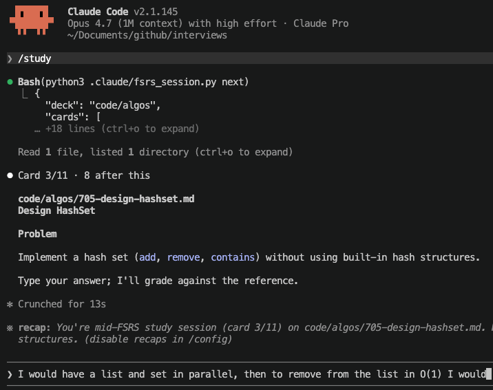

# asrs: agentic spaced-repetition

An agentic spaced-repetition system for **machine learning scientist** interviews. Write notes as markdown, then `/study`. Claude quizzes you, grades your answer.

<p align="center"></p>

## Quickstart

```bash
uv sync          # installs deps (numpy, torch, pytest, fsrs)
```

Then in the Claude Code CLI:

```
/study                  # start a quiz (FSRS-scheduled)
/study code/algos       # start a quiz using subset of notes
/note                   # create a note from the current conversation
```

That's it. `state.db` is created on first run.

## Skills

| Skill          | What it does                                                                    |
| -------------- | ------------------------------------------------------------------------------- |
| `/note`        | Turn the current conversation into a new note. Picks the deck, matches the deck's existing style. |
| `/study`       | Quiz one note from a 10-card batch. Picker uses FSRS.                           |

Both study skills grade as `again` / `hard` / `good` / `easy` and append a block to `history.md`.

## Docs

- [Notes layout](docs/notes.md) — decks, notes, `index.md` format
- [`/study` internals](docs/fsrs.md) — data flow, schema, picker, CLI
- [`/study-asrs` (legacy)](docs/study.md) — multiplier picker, why two exist
