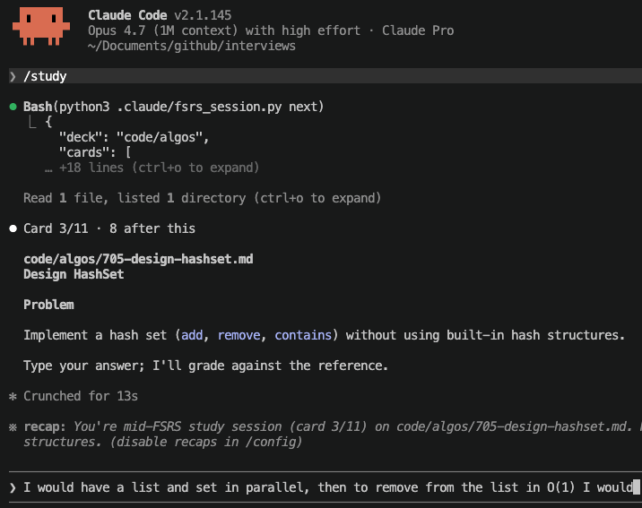

# asrs: agentic spaced-repetition

An agentic spaced-repetition system for Claude Code, built for **machine learning scientist** interviews. Write notes as markdown, then `/study`. Claude quizzes you, grades your answer, and schedules the next review with [FSRS](https://github.com/open-spaced-repetition/py-fsrs).

<p align="center"></p>

## Install

asrs is a Claude Code plugin. Your notes live in your own repo; the plugin supplies the skills.

```
/plugin install asrs --marketplace marawangamal/asrs
```

Answer `y` to add the marketplace, then pick a scope. Requires [`uv`](https://docs.astral.sh/uv/) (the scheduler's one dependency, `fsrs`, is pulled in on first run).

To have a notes repo prompt everyone who opens it to install the plugin, add this to its `.claude/settings.json`:

```json
{
  "extraKnownMarketplaces": {
    "asrs": { "source": { "source": "github", "repo": "marawangamal/asrs" } }
  },
  "enabledPlugins": { "asrs@asrs": true }
}
```

## Use

From the root of your notes repo:

```
/study                  # start a quiz (FSRS-scheduled)
/study notes/math       # quiz from one deck
/note                   # create a note from the current conversation
```

`state.db` and `history.md` are created on first run. Try it on the example vault in this repo (`notes/`).

## Skills

| Skill         | What it does                                                                                      |
| ------------- | ------------------------------------------------------------------------------------------------- |
| `/note`       | Turn the current conversation into a new note. Picks the deck, matches the deck's existing style. |
| `/study`      | Quiz one note from a 10-card batch. Picker uses FSRS.                                             |
| `/study-asrs` | Legacy picker: days-since-review / grade multiplier.                                              |

Both study skills grade as `again` / `hard` / `good` / `easy` and append a block to `history.md`.

## Docs

- [Notes layout](docs/notes.md) — decks, notes, `index.md` format
- [`/study` internals](docs/fsrs.md) — data flow, schema, picker, CLI
- [`/study-asrs` (legacy)](docs/study.md) — multiplier picker, why two exist

## Developing

Run Claude Code with the working copy loaded instead of the installed plugin:

```bash
claude --plugin-dir ~/path/to/asrs
```
