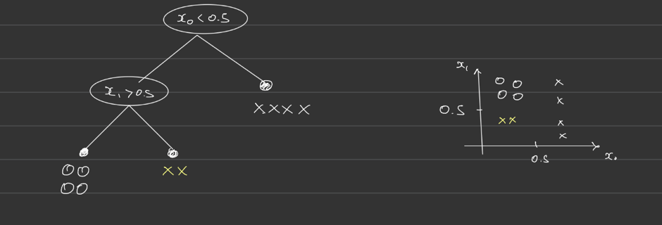

## Tags
ml,decision-tree,recursion,gini,impurity
### Name
Decision tree — inference and greedy training
### Problem
Build a binary tree that predicts class `y` from `x ∈ R^d` by routing left/right on `x[feature] <= threshold` until a leaf, then returning the leaf's stored label. How do you train it?


### Solution
**Inference.** Each node is a `Leaf(label)` or `Branch(feature, threshold, left, right)`. Descend recursively; the leaf's `label` was set at training time to the majority class of the samples that reached it.

**Training.** At each node with data `D`, pick the `(feature, threshold)` minimizing weighted child impurity, then recurse:

$$
(f^*, t^*) = \arg\min_{f, t}\; |D_L|\,I(D_L) + |D_R|\,I(D_R), \quad D_L = \{(x, y) \in D : x_f \le t\}
$$

Gini: `I(D) = 1 − Σ p_c²`. Pure → 0.

**Threshold enumeration.** As you sweep `t ∈ R`, the partition only changes when `t` crosses a sample value. So `I(D_L) + I(D_R)` is a step function of `t` with steps at the sorted unique values of `x_f`. Test one `t` per step — the midpoint between consecutive sorted uniques is the canonical choice. `N − 1` candidates per feature, `O(N log N)` cost.

```python
def gini(labels, num_classes):
    counts = np.bincount(labels, minlength=num_classes).astype(float)
    p = counts / counts.sum()
    return 1 - np.sum(p ** 2)

def best_split(X, y, features, C):
    # X: (N, D), y: (N,) int in [0, C), features: iterable of int feature ids, C: int
    base, best, best_score = gini(y, C) * len(y), None, gini(y, C) * len(y)
    for f in features:
        vals = np.unique(X[:, f])
        for t in (vals[:-1] + vals[1:]) / 2:
            left = X[:, f] <= t
            if left.sum() == 0 or (~left).sum() == 0: continue
            score = gini(y[left], C) * left.sum() + gini(y[~left], C) * (~left).sum()
            if score < best_score:
                best_score, best = score, (f, float(t), left)
    return best
```

Terminate on: depth limit, pure node, or `best_split is None`.

Gotchas:
- `1 - np.sum(p) ** 2` is always 0 — parenthesize as `np.sum(p ** 2)`.
- Sort **uniques**, not raw values, or a repeated value gives a degenerate midpoint equal to a sample.
- Random feature subsampling: thread a `np.random.RandomState(seed)` through; `np.random.choice` (global RNG) breaks determinism across fits.
### Source
Handwritten notes (Wed May 13). See `code/_evals/debug/decision_tree/`.
